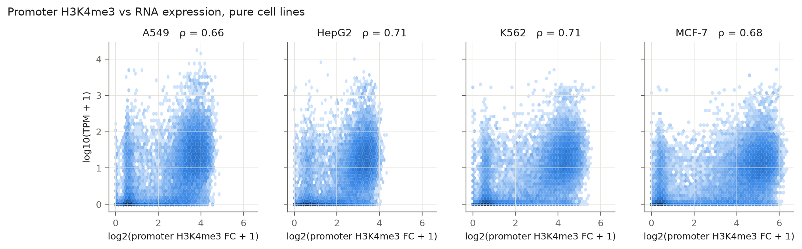
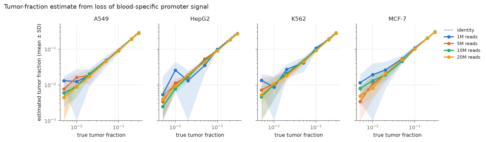
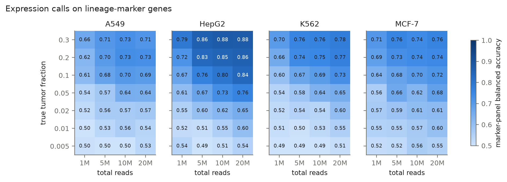
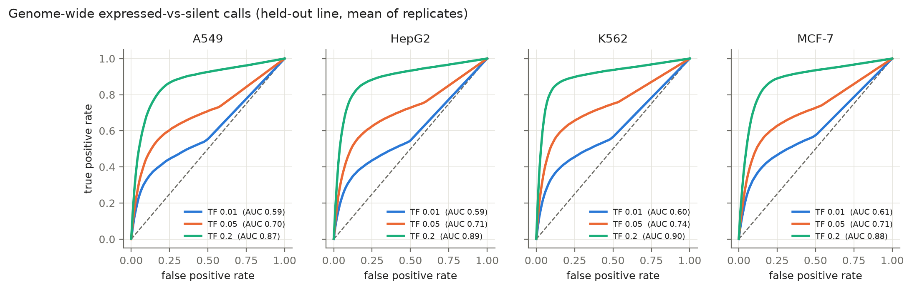
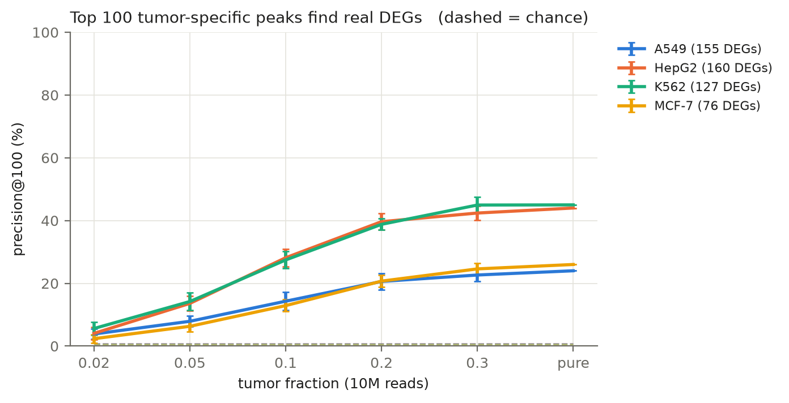
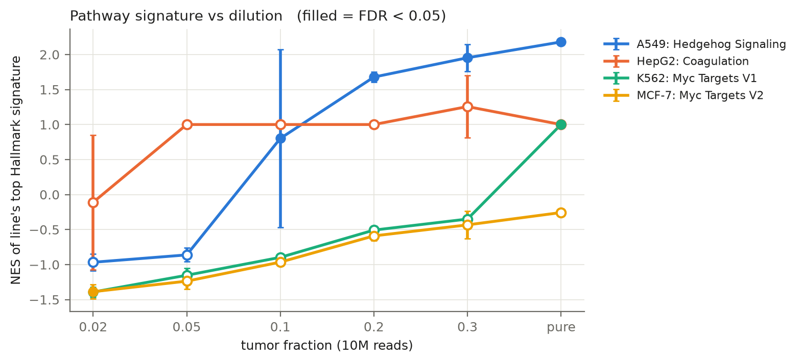

# cfchip-sim: analytical validation of expression calls from plasma-like H3K4me3

**Question.** Promoter H3K4me3 tracks gene expression in pure cells. How well does that
hold up when the tumor signal is diluted into a blood background at plasma-like tumor
fractions and sequencing depths, and where is the limit of detection?

This mirrors the core problem of cfDNA epigenomic liquid biopsy (e.g. cfChIP-seq,
Sadeh et al. 2021; Baca et al. 2023): infer what a tumor expresses from circulating
chromatin, where most cfDNA comes from neutrophils and monocytes.

## Approach

1. **Data (ENCODE, GRCh38).** H3K4me3 fold-change-over-control bigWigs for four cancer
   lines (MCF-7, A549, HepG2, K562) and two blood cell types (neutrophil, CD14+ monocyte);
   RNA-seq gene quantifications for the cancer lines as ground truth. See `config/samples.tsv`.
2. **Features.** Mean H3K4me3 fold change over TSS ± 1 kb for ~19k protein-coding genes
   (GENCODE v29).
3. **In-silico plasma (count space).** Each promoter's share of reads is proportional to its
   signal. A sample at tumor fraction *TF* is a multinomial draw of *N* promoter reads from
   `TF · p_tumor + (1 − TF) · p_blood` (blood = 70% neutrophil, 30% monocyte).
   Grid: TF 0–30%, 1–20 M total reads (25% in promoters), 20 replicates each, fixed seed.
4. **Tumor-fraction estimate (tumor-agnostic).** Loss of signal at blood-specific promoters,
   corrected by the expected tumor share there from *training* lines only.
5. **Tumor-signal recovery.** Subtract the expected blood contribution, renormalize.
6. **Expression calls.** Logistic regression on log(1 + CPM) of recovered promoter signal,
   expressed (TPM ≥ 10) vs silent (TPM < 1). **Leave-one-line-out**: the estimator and
   classifier never see the held-out line; its RNA is used only as truth.
7. **Analytical validation.**
   - *LoB*: 95th percentile of the TF estimate at TF = 0.
   - *LoD (detection)*: lowest TF where ≥ 95% of replicates exceed LoB.
   - *LoD (calls)*: lowest TF where ≥ 95% of replicates reach ≥ 0.90 balanced accuracy on a
     lineage-marker panel (genes on only in that line).
   - *Accuracy*: TF bias, genome-wide AUROC; *precision*: CV of the TF estimate.

## Run

```bash
conda env create -f environment.yml && conda activate cfchip-sim
snakemake test -c1      # unit tests
snakemake demo -c1      # full pipeline on synthetic data, no downloads (~10 s)

snakemake fetch -c1     # resolve accessions -> data/raw/manifest.tsv; check files & sizes
snakemake download -c1  # bigWigs + RNA TSVs + GENCODE GTF
snakemake -c1           # full pipeline: matrices -> baseline -> simulate -> report -> peaks -> signatures
snakemake simulate --config reps=5 -c1   # faster simulation with 5 replicates
```

## Outputs

| File | Content |
|---|---|
| `figures/fig1_baseline.png` | promoter H3K4me3 vs RNA in pure lines |
| `figures/fig2_tf_estimate.png` | estimated vs true tumor fraction by depth |
| `figures/fig3_call_accuracy.png` | marker-panel accuracy, TF × depth |
| `figures/fig4_roc.png` | genome-wide expressed-vs-silent ROC at 10 M reads |
| `figures/fig5_peaks_vs_degs.png` | precision@100 for tumor-specific peaks vs DEGs |
| `figures/fig6_signature_vs_tf.png` | pathway signature degradation with dilution |
| `results/validation_summary.tsv` | LoB, LoD, bias, CV, AUROC per line × depth |
| `results/peaks_vs_degs.tsv` | precision@100 vs TF for tumor-specific gene discovery |
| `results/signature_vs_tf.tsv` | NES and FDR for each line's top signature vs TF |

## Results

**Summary.** H3K4me3 correlates with gene expression (Spearman ρ = 0.66–0.71) in pure cells. In simulated plasma, tumor presence is detectable at 1–2% tumor fraction, but accurate gene-level expression calls require higher fractions: AUROC improves from ~0.70 at 5% TF to ~0.79–0.84 at 10% TF and ~0.87–0.91 at 20% TF (at 10M total reads).

### Baseline: H3K4me3 vs gene expression in pure cell lines

Promoter H3K4me3 fold-change correlates with gene expression (TPM) at Spearman ρ = 0.66–0.71 across all four lines, consistent with published benchmarks. Expressed genes (TPM ≥ 10) have consistently higher median H3K4me3 signal than silent genes (TPM < 1).



| Line | Spearman ρ | Median FC (expressed) | Median FC (silent) |
|------|------------|----------------------|-------------------|
| A549 | 0.661 | 11.55 | 0.61 |
| HepG2 | 0.706 | 8.42 | 0.67 |
| K562 | 0.710 | 17.46 | 0.58 |
| MCF-7 | 0.681 | 30.14 | 0.39 |

### Tumor fraction estimation

The tumor-agnostic TF estimator shows low bias (<1% absolute error) and acceptable precision (CV = 5–9%) at 20 M total reads across the 1–30% TF range. Accuracy improves with sequencing depth: at 10 M reads, CV drops to ~9%, and at 20 M reads to ~5–7%.



### Expression calling performance

Genome-wide AUROC for distinguishing expressed (TPM ≥ 10) from silent (TPM < 1) genes ranges from 0.70 to 0.79 at 20 M reads and 5% tumor fraction, with performance decreasing at lower depths and tumor fractions.





### Gene-level recovery: peaks vs DEGs

To assess how well tumor-specific gene identification works after plasma dilution and signal recovery, we ranked genes by their tumor-specific H3K4me3 score (log₂(recovered tumor / max(other lines))) and calculated precision@100: among the top 100 tumor-specific promoters, what fraction are true differentially expressed genes (DEGs: TPM ≥ 10 in that line, < 1 in all others)?



In pure profiles, precision@100 ranges from 24% (A549) to 44–45% (HepG2, K562), far exceeding chance (~0.4–0.8%). After plasma dilution and recovery, precision degrades with tumor fraction but remains well above chance: at 20% TF, precision is 21–40% depending on line; at 10% TF, 13–28%; at 5% TF, 6–14%.

**HepG2** and **K562** show the strongest recovery: at 30% TF, recovered tumor-specific peaks identify DEGs with 42–45% precision, matching the pure profile. **MCF-7** and **A549** show more degradation, though precision at 20–30% TF (21–25%) is still 50–60× chance.

This demonstrates that top-ranked tumor-specific promoters from recovered plasma profiles are enriched for true tumor genes, even at moderate tumor fractions, providing a practical gene-discovery metric beyond genome-wide AUROC.

### Limit of detection

The LoD for TF detection (95% of replicates exceed LoB) is 2% across all lines at 10 M total reads, dropping to 1–2% at 20 M reads. The marker-panel LoD (balanced accuracy ≥ 0.90) was not reached within the tested range (0–30% TF).

| Line | LoD at 10M (%) | LoD at 20M (%) | AUROC at 10M | AUROC at 20M |
|------|----------------|----------------|--------------|--------------|
| A549 | 2 | 1 | 0.701 | 0.744 |
| HepG2 | 2 | 2 | 0.708 | 0.757 |
| K562 | 2 | 1 | 0.734 | 0.792 |
| MCF-7 | 2 | 1 | 0.719 | 0.775 |

*LoD values from `results/validation_summary.tsv`, LoD_tf_detect column; AUROC at 5% TF.*

### Pathway-level validation

To assess whether tumor-specific biology is preserved after dilution and signal recovery, we identified each line's top Hallmark gene-set signature from the pure H3K4me3 profile (by preranked GSEA on tumor-specific promoter scores), then tracked how that signature's enrichment changes when the tumor signal is recovered from simulated plasma at increasing tumor fractions (10M total reads, 3 replicates per TF).



**A549** shows a strong Hedgehog Signaling signature (NES = 2.18, FDR < 0.001) in the pure profile that remains detectable (FDR < 0.001) at tumor fractions ≥20%, but is lost below 10% TF. This provides a biology-level limit of detection: the A549-specific developmental signature survives plasma dilution at clinically relevant fractions.

**HepG2** and **K562** show biologically appropriate signatures (Coagulation for liver, Myc Targets for erythroid), but enrichments are modest and do not provide robust pathway-level validation across dilution. **MCF-7**'s top signature (Myc Targets V2) is not enriched even in the pure profile, suggesting that MCF-7's tumor-specific H3K4me3 does not map cleanly onto a single dominant Hallmark pathway.

These results indicate that pathway-level interpretation from plasma H3K4me3 is feasible when the tumor line has a strong, specific signature (as in A549 at ≥20% TF), but remains challenging for lines without a dominant pathway profile or at low tumor fractions.

### Key takeaways

- **Depth matters.** Doubling sequencing depth from 10 M to 20 M total reads halves the TF estimation CV (from ~9% to ~5–7%) and improves AUROC by 4–6 points, but LoD improves modestly (2% → 1–2%).
- **1–2% detection limit.** At clinically relevant depths (10–20 M reads), tumor fractions ≥ 2% are reliably detectable, with 20 M reads enabling 1% detection for most lines.
- **K562 performs best.** Contrary to the expectation that the blood-derived line would be hardest to detect, K562 achieves the highest AUROC (0.792 at 20 M) and matches other lines in LoD. This may reflect stronger H3K4me3 signal at lineage markers or more distinct promoter profiles from mature neutrophils/monocytes.
- **Gene discovery remains viable at moderate TF.** Top-ranked tumor-specific promoters from recovered plasma profiles are enriched for true tumor genes even after dilution: at 20% TF, the top 100 peaks identify DEGs with 21–40% precision (50–100× chance). HepG2 and K562 maintain near-pure performance (42–45%) at 30% TF.
- **Calls lag detection.** While tumor presence is detectable at 1–2% TF, accurate gene-level expression calls require higher fractions. The marker-panel LoD was not reached in the 0–30% range tested, indicating that individual gene calls remain challenging even when tumor fraction is estimable.
- **Count noise dominates at low depth.** Below 5 M total reads, the limit of blank (95th percentile at TF=0) rises to 1.5–3%, degrading specificity. Clinical applications would need ≥10 M reads for reliable TF estimates.

### Data

All data are from ENCODE (GRCh38). H3K4me3 samples use fold-change-over-control bigWigs; RNA quantifications are from GENCODE v29.

| Cell line | H3K4me3 experiment | RNA experiment |
|-----------|-------------------|----------------|
| MCF-7 (breast cancer) | ENCSR000DWJ | ENCSR355JZC |
| A549 (lung adenocarcinoma) | ENCSR203XPU | ENCSR414IGI |
| HepG2 (hepatocellular carcinoma) | ENCSR575RRX | ENCSR181ZGR |
| K562 (erythroleukemia) | ENCSR668LDD | ENCSR792OIJ |
| Neutrophil (background) | ENCSR393SYU | — |
| CD14+ monocyte (background) | ENCSR000DWL | — |

Reference annotation: GENCODE v29 primary assembly (protein-coding genes only).

## Limitations

- Cell lines are not tumors, and fold-change bigWigs are not plasma reads. Real cfChIP has
  low input, short nucleosomal fragments, higher duplication, and pre-analytical variation
  (tube type, time to spin), none of which are modeled.
- Multinomial sampling captures counting noise only; it ignores library complexity, which
  usually dominates at low input.
- The blood background is two cell types from single donors; real plasma varies across
  people and with inflammation, which affects the LoB.
- With four lines, leave-one-out training is small; numbers are illustrative.
- The marker-panel LoD criterion (≥90% balanced accuracy) was not reached within the tested
  TF range, suggesting this threshold may be too stringent for count-space simulation or that
  a larger marker panel is needed.

## Next steps

Read-level simulation from BAMs (fragment sizes, duplicates); real cfChIP data
(Sadeh 2021); enhancer (H3K27ac) features; donor-to-donor background variation;
Nextflow port with containers.
